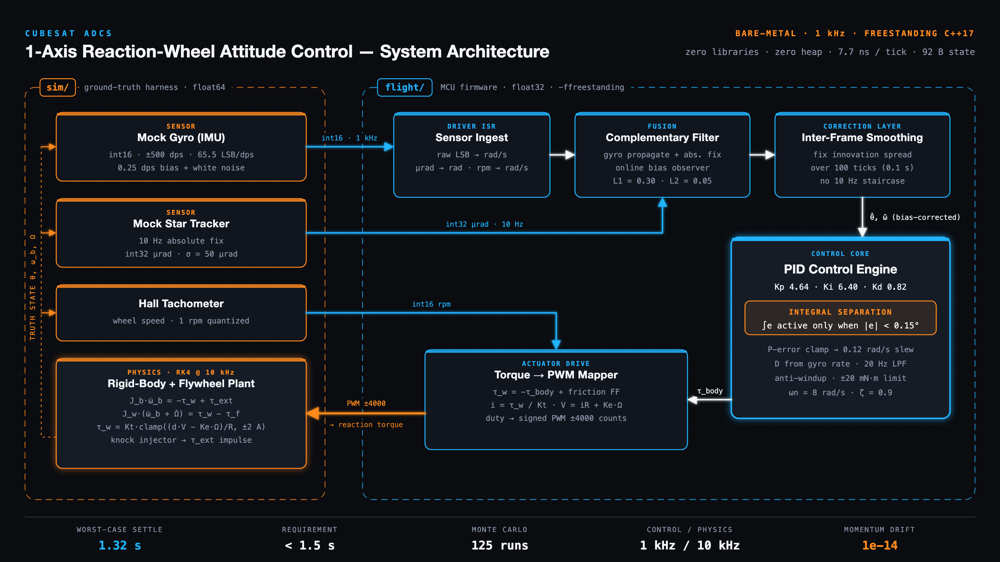
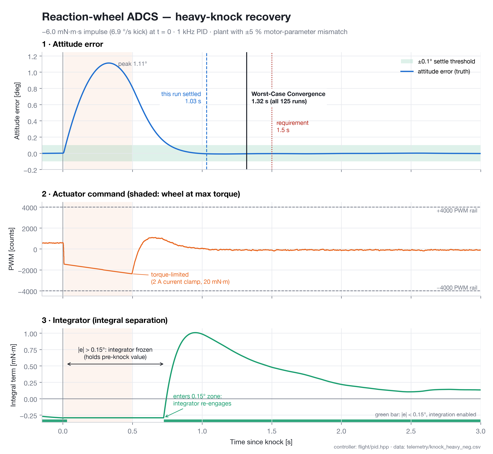

# 1-axis CubeSat Reaction-Wheel ADCS

A ground simulation environment for a single-axis reaction-wheel attitude
controller. The flight software is freestanding C++17. It uses no external
libraries, no libc, no libm, no heap, no exceptions and no RTTI. It runs
closed-loop against a physics plant, mocked raw sensors and injected knocks.

```bash
make test     # build, unit tests, 125 Monte Carlo closed-loop runs, telemetry
make media    # regenerate the architecture diagram and telemetry plot below
```





This builds everything, proves that the flight code compiles freestanding, runs
the unit tests and the 5 × 25 Monte-Carlo closed-loop scenarios, and writes
telemetry to `telemetry/`. The exit code is 0 only if every check passes.

## Layout

| Path | Role |
|---|---|
| `flight/adcs_config.hpp` | Physical constants, motor datasheet values, and the gain design, all `constexpr` |
| `flight/sensor_packets.hpp` | Raw bus packets: gyro LSB, star-tracker µrad, Hall-sensor tach rpm, motor command |
| `flight/pid.hpp` | PID engine: derivative on measurement, D-path low-pass, P error clamp, integral separation, anti-windup |
| `flight/attitude_estimator.hpp` | Gyro propagation, 10 Hz absolute-fix correction, online gyro-bias estimation |
| `flight/rw_controller.hpp` | Control law: estimator → PID → body torque → wheel torque → current → PWM |
| `flight/flight_core.cpp` | `extern "C"` ISR entry points that the firmware links (`adcs_control_isr`, …) |
| `sim/plant.hpp` | Truth physics: rigid body, flywheel, DC motor and bearing friction (double precision, RK4 at 10 kHz) |
| `sim/sensors_mock.hpp` | Mock IMU, star tracker and tach with bias, noise and quantization (deterministic PRNG) |
| `test/harness.cpp` | Unit tests, knock scenarios, settle-time verification, telemetry logging, benchmark |
| `tools/gen_architecture_svg.py` | Generates `architecture_diagram.svg` (standard library only) |
| `tools/plot_telemetry.py` | Generates `telemetry_performance.png` from telemetry CSV (matplotlib) |

## Physics

```
Motor:   i = clamp((duty·Vbus − Ke·Ω) / R, ±Imax)        τm = Kt·i
Bearing: τf = c·sgn(Ω) + b·Ω
Body:    J_b · ω̇_b       = −(τm − τf) + τ_ext            (reaction torque)
Wheel:   J_w · (ω̇_b + Ω̇) =   τm − τf                     (absolute rotor accel)
H = J_b·ω_b + J_w·(ω_b + Ω)   is conserved except for τ_ext
```

| Parameter | Value |
|---|---|
| Body inertia J_b | 0.05 kg·m² (6U, about Z) |
| Wheel inertia J_w | 5×10⁻⁵ kg·m² |
| Motor | Kt = Ke = 0.01, R = 2 Ω, 8 V bus, 2 A limit, so 20 mN·m maximum torque |
| PWM | 20 kHz, ±4000 counts |
| Gyro | ±500 dps, 65.5 LSB/dps, 0.25 dps bias, 0.067 dps σ per sample |
| Star tracker | 10 Hz, 50 µrad σ |

The plant deliberately differs from the nominal values that the flight code
assumes: Kt is 3 % low, R is 5 % high, and friction is 25 % higher. A constant
5 µN·m disturbance also acts on the body.

## Control design

The PID gains come from pole placement on `J s³ + Kd s² + Kp s + Ki`. The poles
are at ωn = 8 rad/s, ζ = 0.9, plus an integrator pole at 2 rad/s, which gives
Kp = 4.64, Ki = 6.4 and Kd = 0.82.

| Technique | Why it is there |
|---|---|
| Derivative from the gyro, not from a differentiated error | No noise amplification and no setpoint kick |
| P-error clamp, `e_max = ω_max·Kd/Kp` | Under torque saturation the loop slews at a constant 0.12 rad/s instead of overshooting |
| Integral separation (\|e\| < 0.15°) plus conditional anti-windup | Knocks cannot charge the integrator. Without this, heavy-knock settling was 1.9 s |
| Back-EMF and friction feed-forward | Turns a torque command into the correct PWM duty at any wheel speed |
| Star-tracker corrections spread over the fix interval | Stops a 10 Hz staircase in the attitude estimate from being chased as rate jitter. This was the last failure mode |
| Attitude seeded from the first fix | Otherwise an initial pointing offset is misread as gyro bias |

Each control tick costs about 8 ns on the host (Apple Silicon, `-O2`). The
controller uses 92 bytes of static state and contains no divisions.

## Results (`make test`)

Settled means that |error| < 0.10° and |rate| < 0.05 °/s, and that the system
stays inside both bands for the rest of the run. Settle time is measured from
knock onset. Each scenario runs 25 noise seeds, and the table shows the worst
case.

| Scenario | Mean | Worst | Peak error |
|---|---|---|---|
| +2.5 mN·m·s knock | 0.69 s | 1.05 s | 0.21° |
| −6.0 mN·m·s heavy knock (saturates the wheel) | 1.04 s | 1.06 s | 1.10° |
| Knock drives the wheel through 0 rpm | 0.68 s | 0.94 s | 0.20° |
| Two opposite knocks 0.4 s apart | 1.17 s | 1.20 s | 0.33° |
| 3° initial pointing error | 1.27 s | 1.32 s | 3.00° |

The unit tests check four things:
- Momentum drift is 1e-14 with no external torque.
- A knock delivers its exact impulse to the momentum.
- The integrator does not wind up.
- The gyro bias is learned to 0.003 dps.

## Telemetry

`telemetry/<scenario>.csv` has one row per 1 ms tick and records truth and
estimated angle and rate, raw gyro LSB, bias estimate, wheel rpm and commanded
rpm, PWM counts, duty, commanded and actual torque, current, the P/I/D terms,
external torque and total momentum. `telemetry/summary.csv` holds the
worst-case results for each scenario.

## Scope and limits

- Only one axis is modelled, so there is no gyroscopic cross-coupling.
- Momentum dumping (magnetorquers) is not modelled. The wheel never comes near
  its 6000 rpm limit in these scenarios.
- Motor winding inductance is ignored, because its electrical time constant is
  far below the 1 ms control period.
- The cycle count was measured on the host. It has not been measured on a
  Cortex-M target.
